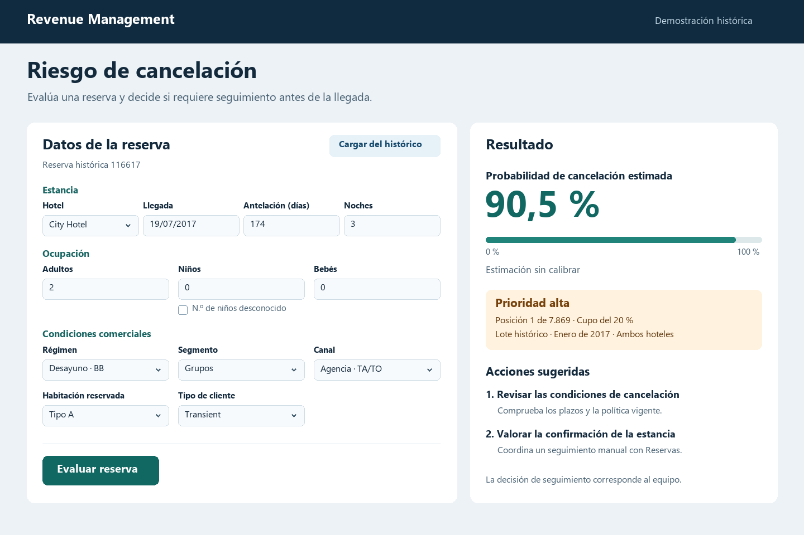

# Entrega 04 · Diseño del frontal y experiencia de usuario

**Proyecto:** Predicción de Cancelaciones de Reservas Hoteleras  
**Usuario principal:** equipo de Revenue Management, en coordinación con Reservas.

## 1. Utilidad y valor del producto

Revenue Management dispone de tiempo limitado para revisar reservas antes de la llegada. El frontal permite consultar una reserva, evaluar su riesgo de cancelación y decidir si conviene revisar sus condiciones, coordinar una confirmación manual o continuar con el seguimiento habitual. La decisión y su ejecución corresponden al equipo.

El MVP final dispondrá de un formulario de evaluación individual, una ficha con la estimación del modelo y acciones sugeridas, y una consulta de reservas históricas de un lote cerrado. La consulta histórica aporta contexto de posición y cupo a la ficha. La evaluación individual queda disponible cuando solo se dispone de los datos de una reserva.

## 2. Flujo de usuario

1. Desde **Inicio**, el usuario abre **Evaluación** para introducir datos o **Histórico** para recuperar una reserva de validación o prueba.
2. En **Histórico** puede buscar por ID y combinar filtros de hotel, partición, mes de alta estimada y prioridad. La tabla se pagina y comunica el número de coincidencias.
3. **Abrir** lleva al formulario con los valores del Gold y muestra la estimación ya guardada, posición, lote y acciones orientativas. Si cambia un campo o limpia el formulario, la estimación histórica se retira.
4. En entrada manual, **Validar datos** comprueba los campos y señala los errores junto al control. La predicción manual permanece desactivada hasta conectar el pipeline. El cálculo y su estado de espera se incorporarán con la inferencia.

## 3. Diseño del frontal

[Pantalla principal a tamaño completo](../assets/04_mockup_frontal_ux.png)

La imagen muestra el estado posterior a la evaluación de la fila histórica **116617** del bloque de prueba, con llegada el 19/07/2017. Sus campos proceden del Gold y el score logístico de `reports/ml_predicciones.csv`. El valor mostrado, **90,5 %**, redondea la salida del modelo. La prioridad proviene del lote de altas estimadas de enero de 2017, con **7.869** reservas y **1.573** plazas de revisión. La posición se obtiene al aplicar el orden de la Entrega 03. El resultado final de la reserva queda fuera de la ficha.

### Prototipo interactivo

| Pantalla | Uso |
| --- | --- |
| [Inicio](../assets/04_prototipo_inicio.png) | Resume el histórico y da acceso a las dos tareas principales. |
| [Histórico con filtros](../assets/04_prototipo_historico.png) | Permite comparar estimaciones y abrir una ficha concreta. |
| [Evaluación y resultado](../assets/04_prototipo_evaluacion.png) | Muestra el formulario con la reserva 116617 y el resultado de TMF3. |
| [Evaluación en móvil](../assets/04_prototipo_movil.png) | Coloca el resultado debajo del formulario y mantiene las acciones accesibles. |

El prototipo está en [prototipo/index.html](../../prototipo/index.html). Ejecuta el servidor local siguiendo el [README](../../README.md). El mockup superior recoge el diseño inicial y las capturas documentan la versión interactiva.

## 4. Experiencia de usuario

- **Jerarquía y controles.** El formulario agrupa estancia, ocupación y condiciones comerciales. Las categorías se seleccionan mediante listas con etiquetas comprensibles y códigos de origen cuando ayuden a reconocerlas. La llegada usa un selector de fecha y los recuentos aceptan enteros. El botón de validación cierra el formulario y el resultado queda a su lado en escritorio. La tabla emplea desplazamiento horizontal dentro de su propio contenedor en pantallas estrechas. En pantallas estrechas el resultado aparece debajo.
- **Lectura del riesgo.** El porcentaje y la barra lineal muestran la magnitud en una escala de 0 a 100. El texto «Estimación sin calibrar» acompaña al porcentaje porque la Entrega 03 carece de calibración acreditada para interpretar el score como probabilidad individual. El nivel operativo utiliza las etiquetas «Prioridad alta», «Fuera del cupo» y «Prioridad sin evaluar». El color refuerza las etiquetas y la posición informa del contexto. Quedar fuera del cupo sigue siendo compatible con una cancelación.
- **Validación y recuperación.** Una fecha inválida, un campo obligatorio vacío o un recuento negativo bloquean el cálculo con mensajes junto al campo y foco en el primer error. El cero y el dato desconocido de niños se mantienen diferenciados. Una estancia u ocupación declarada de cero genera un aviso para verificar datos. La carga inicial muestra un estado de espera y, si falla, ofrece reintentar. La futura inferencia conservará el formulario ante errores y retirará cualquier resultado obsoleto. Las categorías ajenas al catálogo requieren revisar su correspondencia antes de evaluar.
- **Accesibilidad y decisión.** La interfaz incluye etiquetas visibles, navegación por teclado, foco visible, mensajes de estado y foco en el primer campo inválido. Las sugerencias son pasos de revisión humana. El histórico mide detección de cancelaciones y carece de evidencia sobre el efecto de contactar al huésped.

## 5. Continuidad hacia el MVP final

### Prototipo operativo

La aplicación estática ya incluye navegación, entrada y validación manual, búsqueda, filtros, paginación, carga de fichas y visualización de resultados históricos. El exportador de TFM4 une el Gold y las predicciones de TMF3 por ID técnico y genera un JSON local con las 40.576 filas de validación y prueba. El navegador conserva la posición del lote original al filtrar. Las reglas de seguimiento se muestran en un bloque de acciones separado.

### MVP para la presentación final

- Conectar el formulario existente al servicio local de inferencia y habilitar el cálculo con estados de espera, error y resultado.
- Reutilizar el Gold de la Entrega 02 (`data/processed/hotel_bookings_prepared.csv`) y el pipeline de regresión logística de la Entrega 03 (`src/machine_learning.py`). El código actual ajusta el pipeline y exporta las predicciones; la integración deberá reutilizar el ajuste original con su bloque de entrenamiento y dependencias fijadas, y cargar el pipeline ajustado una vez al iniciar la demo. El flujo se probará comparando el score de una fila de prueba con la exportación histórica.
- El formulario entrega 13 predictores. Transforma la fecha de llegada en `arrival_date_month` con el vocabulario del Gold. Antelación y noches totales alimentan `lead_time` y `total_nights`; los campos de ocupación alimentan `adults`, `children`, `babies` y `children_missing`. «Desconocido» pasa `children` como nulo y `children_missing=1`. El resto se mapea a `hotel`, `meal`, `market_segment`, `distribution_channel`, `reserved_room_type` y `customer_type`. El pipeline aplica imputación, escalado y codificación aprendidos. La etiqueta, el país y los metadatos quedan fuera de la inferencia individual.
- El servicio local devuelve la estimación de la clase `is_canceled=1` mediante `predict_proba`. Para un caso histórico sin editar, une Gold y predicciones por `meta_row_id` / `id` y añade mes, posición y prioridad. Se ordena el lote de la misma partición y mes por score descendente, luego por SHA-256 de `42|id` e ID ascendente. El cupo es el 20 % redondeado hacia abajo y combina ambos hoteles, como en la evaluación original. El ID técnico se usa para localizar y desempatar casos históricos. Los textos de acción se eligen en la interfaz según el contexto de revisión.

### Mejoras futuras

- Conectar el sistema de reservas mediante instantáneas al alta e identificadores internos seudonimizados. Validar prospectivamente la calidad de datos, la calibración y el rendimiento por hotel, canal y antelación antes del piloto. El histórico de dos hoteles portugueses con llegadas de 2015 a 2017 limita la generalización, y la Entrega 03 detectó baja cobertura en canal directo.
- Diseñar una cola operativa con cadencia, cupos por equipo y seguimiento de decisiones. Medir la carga y el efecto de las intervenciones antes de ampliar el flujo. El cupo mensual retrospectivo se conserva para la demostración.

**Fuentes locales de continuidad.** Entrega 02 en `TFM2/docs/entregas/02_datos_y_preparacion.md` y Entrega 03 en `TMF3/docs/entregas/03_machine_learning.md`, ambas en carpetas hermanas de TFM4.
